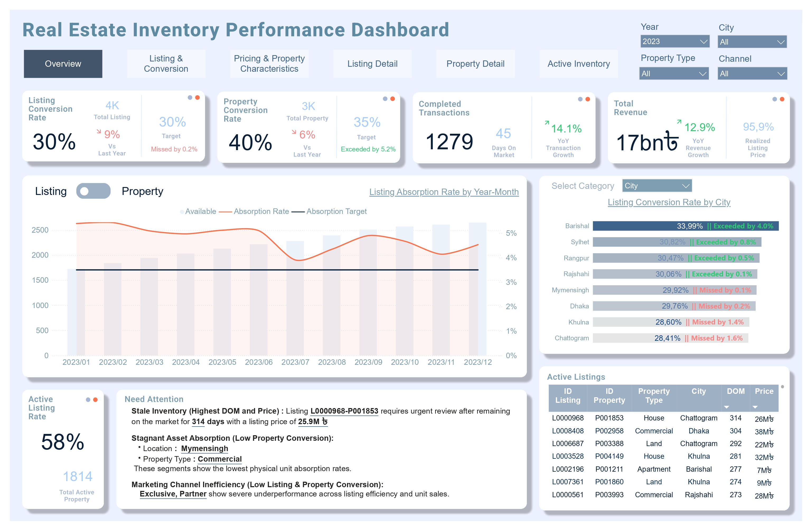

# Real Estate Inventory Performance Analysis

## 1. Business Overview

Company X is a real estate agency that acts as an intermediary between property owners and prospective buyers or tenants. Its primary source of revenue comes from commissions generated through successfully completed property transactions.

In its operations, a single property can be marketed through multiple listings managed by different agents to expand market reach and increase conversion opportunities. Therefore, effective listing management plays an important role in improving overall property conversion performance.

*For a more comprehensive understanding of the business model and operational processes, see [1_Business_Overview.md](1_Business_Overview.md).*

## 2. Project Overview

This project applies an **End-to-End Data Analytics** approach to evaluate property conversion performance and inventory management effectiveness over the 2022–2024 period.

The analysis is designed to support the Sales Manager in evaluating inventory efficiency, identifying conversion challenges, and improving sales performance.

The analysis focuses on three key areas:

1. **Conversion Performance:** Evaluating how effectively properties and listings are converted into successfully completed transactions.
2. **Inventory Performance:** Analyzing property and listing inventory movements, including inventory growth and absorption trends over time.
3. **Conversion Drivers:** Identifying property characteristics and business segments associated with differences in conversion performance.

*For further details on the business objectives, project scope, and analytical framework, see [2_Project_Understanding.md](2_Project_Understanding.md).*

## 3. Dataset

The dataset used in this project was obtained from Kaggle:

[Real Estate Analytics: Revenue, Behavior and Churn](https://www.kaggle.com/datasets/emonsharkar/real-estate-analytics-revenue-behavior-and-churn)

- **Data Source:** Kaggle
- **Analysis Period:** 2022–2024

## 4. Data Processing & Tools

This project follows an end-to-end data analytics workflow, covering data preparation, database management, exploratory analysis, dashboard development, and result validation.

### Data Processing Workflow

1. **Data Cleaning:** Cleaning and preparing raw datasets using Python to ensure data quality and consistency.
2. **Database Management:** Storing and managing processed datasets in PostgreSQL.
3. **Data Analysis:** Performing exploratory data analysis and business analysis using Python and SQL.
4. **Dashboard Development:** Building an interactive dashboard using Power BI and DAX to communicate key business insights.
5. **Data Validation:** Validating dashboard calculations and analytical results using Python.

### Tools & Technologies

 **Python** : Data cleaning, exploratory data analysis, and data validation 
 **PostgreSQL** : Database management and data retrieval using SQL 
 **Power BI** :  Data modeling, DAX calculations, and interactive dashboard development 

*For a detailed explanation of the data preparation and processing workflow, see [3_Data_Process_Understanding.md](3_Data_Process_Understanding.md).*

## 5. Dashboard Overview

The interactive Power BI dashboard provides an overview
of real estate inventory performance across key business
dimensions, enabling stakeholders to monitor conversion
performance, inventory trends, and potential areas for improvement.

**Dashboard Files:**
- [Download Power BI Dashboard (.pbix)](Real Estate Inventory Performance Dashboard.pbix)
- [View Dashboard Report (.pdf)](Real Estate Inventory Performance Dashboard.pdf)

## 6. Key Findings

The analysis identified several key findings regarding property inventory management and sales performance:

1. Available inventory continued to grow at a faster rate than completed transactions.
2. Carry-over inventory accumulated over time, while its contribution to completed transactions remained relatively low.
3. Property conversion performance declined consistently throughout the analysis period.
4. Sales performance varied significantly across property segments.
5. Affordable apartments represented a key strength within the existing property inventory.
6. Agent workload alone did not explain differences in agent conversion performance.
7. Increasing the number of listings per property did not necessarily accelerate property conversion.
8. Revenue optimization opportunities varied across locations and property types.

*For detailed findings, supporting analysis, and business insights, see [4_Key_Findings.md](4_Key_Findings.md).*

## 7. Business Recommendations

Based on the analytical findings, four strategic priorities are proposed to improve inventory efficiency and overall sales performance:

1. **Implement Inventory Aging Management**
2. **Improve Listing Conversion Performance** 
3. **Develop Segment-Based Sales Strategies** — Growth Opportunity
4. **Establish Inventory Acquisition Controls**

*For detailed recommendations, proposed action plans, and performance measurement indicators, see [5_Actionable_Recommendations.md](5_Actionable_Recommendations.md).*

## 8. Conclusion

This analysis highlights the importance of aligning inventory acquisition, listing management, and sales strategies with actual conversion performance.

By identifying inventory inefficiencies and understanding the factors associated with successful conversions, the company can establish more effective inventory management practices, prioritize high-potential property segments, and improve overall sales performance.